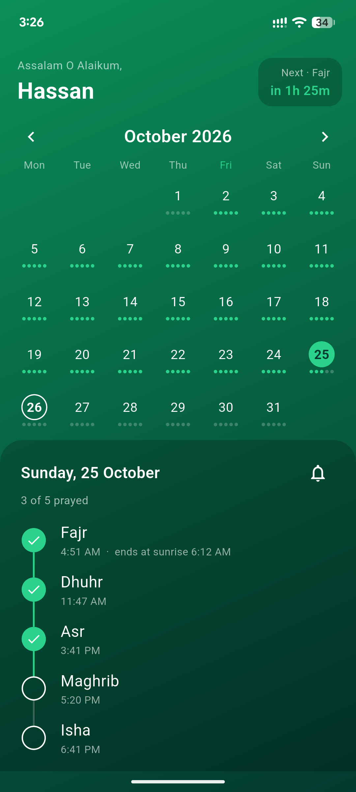
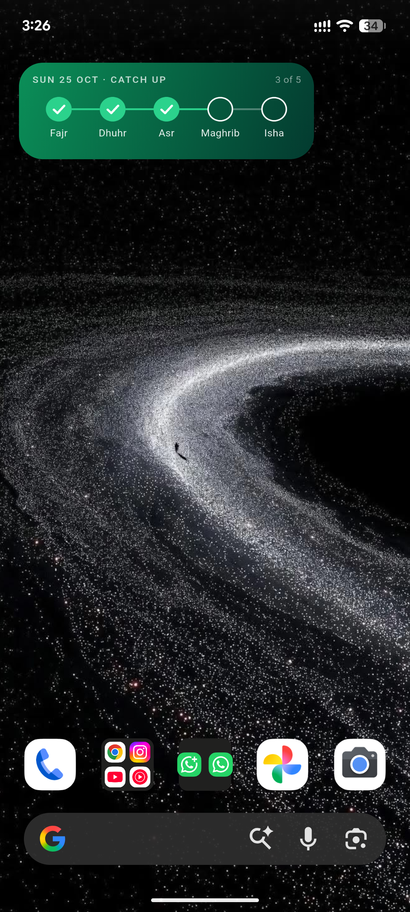
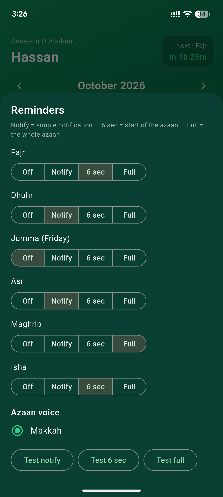

# Prayer Tracker

A simple one-page Android app for tracking your five daily prayers, built with Flutter.

Pick a date on the calendar, tick off **Fajr, Dhuhr (Jumma on Fridays), Asr, Maghrib and Isha** as their time arrives, and see your progress at a glance. A home-screen widget lets you tick prayers without even opening the app.

<table>
  <tr>
    <td align="center"></td>
    <td align="center"></td>
    <td align="center"></td>
  </tr>
  <tr>
    <td align="center">Calendar and prayers</td>
    <td align="center">Home-screen widget</td>
    <td align="center">Reminder settings</td>
  </tr>
</table>

## Features

- **Calendar** with a small progress dot for every prayer you ticked on each day
- **Prayer times calculated on the phone**, so the app works offline (Karachi method, Hanafi Asr)
- **Prayers stay locked until their time arrives**, so you can't tick tomorrow's prayers or one that hasn't started
- **Jumma on Fridays**, with its own reminder setting separate from Dhuhr
- **Sunrise time** shown on the Fajr row, so you know when Fajr ends
- **Greeting header** with a countdown to the next prayer
- **Smooth month swiping** and a month/year picker
- **Reminders for each prayer**, chosen individually:
  - Off
  - Simple notification
  - Short azaan (the first few seconds)
  - Full azaan
- **Choice of azaan voice**, with test buttons
- **Home-screen widget**
  - Five circles: ticked, time passed but not prayed, or not yet time
  - Tap a circle to tick that prayer straight from the home screen
  - Shows a "catch up" row for missed prayers from the last 7 days
  - Refreshes itself at every prayer time

## Built with

- [Flutter](https://flutter.dev)
- [`adhan_dart`](https://pub.dev/packages/adhan_dart) for prayer time calculation
- [`home_widget`](https://pub.dev/packages/home_widget) for the home-screen widget
- [`flutter_local_notifications`](https://pub.dev/packages/flutter_local_notifications) for reminders
- [`shared_preferences`](https://pub.dev/packages/shared_preferences) for saving your ticks and settings

## Getting started

You need [Flutter](https://docs.flutter.dev/get-started/install) and an Android phone (or emulator).

```
git clone https://github.com/HassanAmin-67/Prayer-Tracker.git
cd Prayer-Tracker
flutter pub get
```

### Add an azaan audio file

The azaan recording is **not included** in this repository, because audio recordings are usually copyrighted. Add your own, using a file you are allowed to use:

1. Name it `azaan_makkah.mp3` (lowercase letters, digits and underscores only).
2. Put it in `android/app/src/main/res/raw/`.

Without it the build fails, so if you don't want an azaan, remove the `AzaanOption(...)` line from `azaanOptions` in `lib/reminders.dart`.

To add more voices, put each file in the same folder with a name starting with `azaan_`, and add one line to `azaanOptions` in `lib/reminders.dart`:

```dart
const azaanOptions = [
  AzaanOption('azaan_makkah', 'Makkah'),
  AzaanOption('azaan_madinah', 'Madinah'), // your new file: azaan_madinah.mp3
];
```

### Run it

Connect your phone with USB debugging on, then:

```
flutter run
```

If the build complains about the Android NDK version, change `ndkVersion` in `android/app/build.gradle.kts` to the version it asks for.

For everyday use without a cable, install the release build with `flutter run --release`.

### Set your location

Prayer times use fixed coordinates for **Lahore, Pakistan**. To use another city, change the coordinates in two places:

- `coordinates` in `lib/main.dart`
- `_coordinates` in `lib/prayer_logic.dart`

```dart
const Coordinates(31.5497, 74.3436)
```

## Project structure

| File | What it does |
| --- | --- |
| `lib/main.dart` | The screens: calendar, prayer list, settings and header |
| `lib/prayer_logic.dart` | Prayer times, the widget's logic, drawing and tap handling |
| `lib/widget_card.dart` | The design of the home-screen widget |
| `lib/reminders.dart` | Notifications and azaan options |
| `android/.../PrayerWidgetProvider.kt` | The Android side of the widget |

## Notes

- Reminders are scheduled **30 days ahead** each time you open the app, so open it now and then.
- Don't use **Force stop** on the app in Android settings. It cancels the scheduled reminders and widget refreshes until the app is opened again.
- Calculated prayer times can differ by a few minutes from your local mosque timetable.